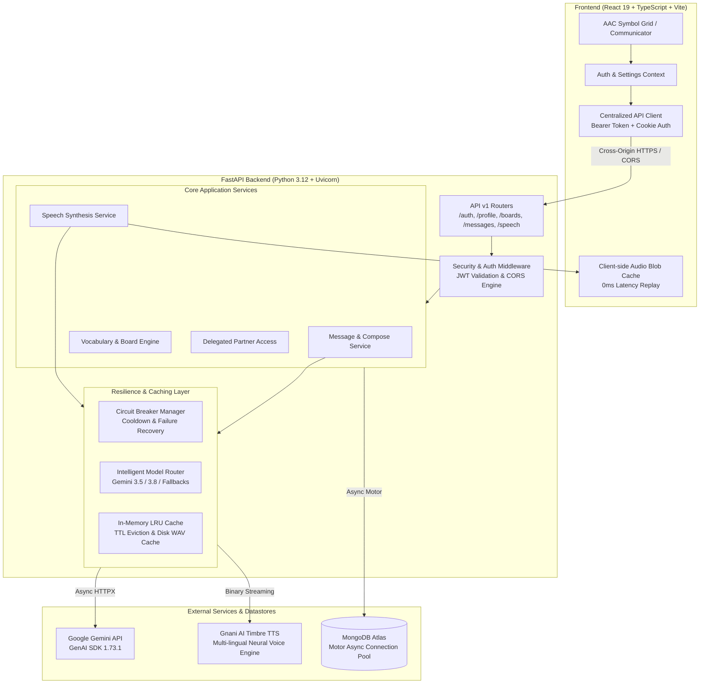

<div align="center">

# 🗣️ SAMAAN AI (सम्मान)
### Assistive & Augmentative Communication (AAC) Platform

*Empowering independence, dignity, and expression through visual symbol boards, intelligent grammar synthesis, and natural multilingual neural voices.*

[](https://www.python.org/downloads/)
[](https://fastapi.tiangolo.com)
[](https://react.dev)
[](https://www.typescriptlang.org)
[](https://vitejs.dev)
[](https://www.mongodb.com/)
[](https://opensource.org/licenses/MIT)

[Live Application](https://samman-ai.vercel.app) • [Backend API Docs](https://samaan-ai-backend.onrender.com/docs) • [Architecture](#-system-architecture) • [Getting Started](#-getting-started)

</div>

---

## 📖 Executive Summary

**SAMAAN AI** (*सम्मान* meaning *Dignity* and *Respect*) is a production-grade Assistive & Augmentative Communication (AAC) platform engineered for individuals with speech and motor challenges. This includes non-verbal children and adults, stroke survivors with aphasia, individuals on the autism spectrum, people with cerebral palsy or ALS, and intensive care (ICU) patients.

Unlike traditional static symbol grids or unconstrained voice assistants, SAMAAN AI pairs **deterministic concept-based visual symbols** with **Google Gemini language models** and **Gnani AI Timbre neural speech synthesis**, all governed by a strict, clinically aligned **Human Approval Invariant**.

---

## 🏛️ System Architecture

SAMAAN AI follows a decoupled, asynchronous, high-concurrency architecture:



---

## 🛡️ Core Architectural Invariants & Principles

### 1. The AAC Human Approval Invariant
In AAC clinical guidelines, an assistive system must never vocalize words that the communicator did not deliberately choose. SAMAAN enforces this at both API and business layers:
- The user selects discrete concept symbols (e.g., `["I want", "water", "cold"]`).
- Gemini synthesizes candidate sentences (e.g., *"May I please have a glass of cold water?"*).
- **The message is marked `pending`. Speech synthesis endpoints (`/messages/{id}/speech`) return `403 Forbidden` if invoked on an unapproved message.**
- Only upon explicit user approval does the status transition to `approved`, unlocking the speech pipeline.

### 2. Zero-Hallucination & Safe Literal Fallback
AI models can encounter outages, network timeouts, or rate limits. SAMAAN guarantees that the user is **never silenced**:
- If Gemini APIs return `503 UNAVAILABLE`, `429 RATE_LIMIT`, or time out, the system trips an internal **Circuit Breaker** and activates a deterministic **Literal Fallback** candidate.
- Concept sequence is joined into literal text with full validation metadata (`fallback_used: true`, `reason: "all_models_unavailable"`).
- The user can immediately vocalize their literal concepts without delay.

### 3. Sub-Millisecond Multi-Tier Replay Caching
To maintain natural conversation flow, communication cannot wait for external API round-trips:
- **L1 (Client-side Blob Cache):** Synthesized audio is cached in-browser (`clientAudioCache`), allowing instant **0.0ms replay** of frequent sentences.
- **L2 (Server-side LRU & Disk Cache):** Synthesized `.wav` streams are cached in backend memory and filesystem by `sha256(text:language:voice)`.
- Replay benchmark: Raw API $6.71\text{s} \to$ Cached **$<0.1\text{ms}$** ($>600,000\times$ faster).

### 4. Cross-Origin Production Security & Hybrid Auth
- **Bearer Token Authorization:** The centralized frontend client [`frontend/src/lib/api.ts`](frontend/src/lib/api.ts) stores JWT access tokens securely in memory and `localStorage`, injecting `Authorization: Bearer <token>` into every HTTP request.
- **Cross-Origin Cookie Support:** Backend sets `SameSite=None; Secure=True` in production so browsers handle third-party cookies across differing domains (`samman-ai.vercel.app` $\leftrightarrow$ `samaan-ai-backend.onrender.com`).
- **Dynamic CORS Engine:** Permissive regex matching (`^https://.*\.vercel\.app$`) permits production and all Vercel preview branch deployments without manual reconfiguration.

---

## ✨ Features Breakdown

| Feature | Description |
| :--- | :--- |
| **Visual Symbol Board Engine** | Grid-based symbols categorized by Fitzgerald keys (Needs, Feelings, Health, People, Actions, Comfort). Supports custom board and tile creation. |
| **Gemini AI Sentence Composer** | Real-time grammar expansion using verified Google Gemini models (`gemini-3.5-flash-lite`, `gemini-3.8-flash`, `gemini-flash-lite-latest`). |
| **Gnani Timbre Neural Voices** | High-fidelity neural voice synthesis tailored for Indian accents and languages: **English (Indian), Hindi (हिंदी), Kannada (ಕನ್ನಡ), Tamil (தமிழ்), Telugu (తెలుగు)**. |
| **Caregiver & Partner Delegation** | Role-based delegated access (`view_boards`, `assist_compose`, `view_history`) with expirations and revocations for therapists and family members. |
| **Accessibility-First Controls** | WCAG 2.1 AAA accessible UI: custom tile sizing (small, medium, large), high-contrast palette, and reduced motion modes. |
| **Offline-Ready Phrase Book** | Instant 1-tap playback for emergency alerts, medical requests, and frequent phrases. |

---

## 📂 Project Structure

```text
samman-ai/
├── .python-version                # Pinned Python 3.12.11 for Render runtime
├── .gitignore                     # Comprehensive secrets & environment filter
├── docker-compose.yml             # (Optional) Local full-stack orchestration
│
├── backend/                       # FastAPI REST API Backend
│   ├── .python-version            # Sub-root Python version enforcement
│   ├── requirements.txt           # Pinned dependencies (motor 3.7, email-validator)
│   ├── .env.example               # Backend environment variables template
│   ├── app/
│   │   ├── main.py                # App entrypoint, lifespan hooks, CORS & health checks
│   │   ├── api/v1/                # Endpoint controllers (auth, boards, messages, speech...)
│   │   ├── core/                  # Configuration, database connection, cache, security
│   │   ├── modules/               # Domain business logic (auth, boards, messages, speech)
│   │   ├── repositories/          # MongoDB Motor async data access layers
│   │   ├── schemas/               # Pydantic v2 validation models
│   │   ├── ai/                    # Gemini adapter, model router, prompt builders, validators
│   │   └── integrations/          # Gnani AI Timbre client & metrics collector
│   └── tests/                     # Automated test suite (CORS, resilience, auth)
│
└── frontend/                      # React 19 + TypeScript + Vite Client
    ├── package.json               # Frontend dependencies (Lucide, Framer Motion)
    ├── vite.config.ts             # Vite dev server, dynamic proxy, loadEnv
    ├── .env                       # VITE_BACKEND_URL configuration
    └── src/
        ├── components/            # Reusable UI components & layouts
        ├── lib/                   # Centralized API client & Speech engine
        ├── pages/                 # Route views (Landing, Login, Dashboard, Communicate...)
        └── store/                 # Reactive Context providers (Auth, Settings, Phrases)
```

---

## 📡 API Inventory & Endpoint Reference

All protected endpoints accept either `Authorization: Bearer <token>` or HttpOnly session cookies.

### Authentication & Profile
| Method | Path | Description | Auth Required |
| :--- | :--- | :--- | :---: |
| `POST` | `/api/v1/auth/register` | Create a new communicator account | No |
| `POST` | `/api/v1/auth/login` | Authenticate and receive JWT + cookie | No |
| `POST` | `/api/v1/auth/logout` | Terminate session and clear cookie | Yes |
| `GET` | `/api/v1/auth/me` | Retrieve authenticated user profile | Yes |
| `GET` | `/api/v1/profile` | Retrieve visual & accessibility settings | Yes |
| `PATCH` | `/api/v1/profile` | Update tile size, contrast, or language | Yes |

### Boards & Vocabulary
| Method | Path | Description | Auth Required |
| :--- | :--- | :--- | :---: |
| `GET` | `/api/v1/boards` | List user's active vocabulary boards | Yes |
| `POST` | `/api/v1/boards` | Create a new custom categorized board | Yes |
| `GET` | `/api/v1/boards/{id}/vocabulary` | Retrieve symbol tiles for a board | Yes |
| `POST` | `/api/v1/boards/{id}/vocabulary` | Add custom symbol tile to a board | Yes |
| `DELETE`| `/api/v1/boards/{id}` | Soft-delete a vocabulary board | Yes |

### Message Composition & Human Approval
| Method | Path | Description | Auth Required |
| :--- | :--- | :--- | :---: |
| `POST` | `/api/v1/messages/compose` | Submit concept tokens $\to$ get AI sentences | Yes |
| `GET` | `/api/v1/messages` | List communication history | Yes |
| `POST` | `/api/v1/messages/{id}/approve` | Explicitly approve sentence for vocalization | Yes |
| `DELETE`| `/api/v1/messages/{id}/approval`| Invalidate approval for re-editing | Yes |

### Neural Speech Synthesis (TTS)
| Method | Path | Description | Auth Required |
| :--- | :--- | :--- | :---: |
| `POST` | `/api/v1/messages/{id}/speech` | Synthesize approved sentence (`audio/wav`) | Yes |
| `POST` | `/api/v1/speech/synthesize` | Direct speech synthesis for quick phrases | Yes |
| `GET` | `/api/v1/speech-jobs/{id}` | Check async speech job status | Yes |

### Caregiver Delegation & Health
| Method | Path | Description | Auth Required |
| :--- | :--- | :--- | :---: |
| `GET` | `/api/v1/partners` | List active delegated caregivers | Yes |
| `POST` | `/api/v1/partners` | Grant caregiver permission by ID / Email | Yes |
| `DELETE`| `/api/v1/partners/{id}` | Revoke caregiver delegation | Yes |
| `GET` | `/` | Root deployment descriptor | No |
| `GET` | `/health` / `/api/v1/health` | Operational database health probe | No |

---

## 🚀 Getting Started

### Prerequisites
- **Python:** 3.12.x (Recommended: 3.12.11)
- **Node.js:** 20.x or 22.x
- **MongoDB:** Active Atlas cluster or local instance (v6.0+)
- **API Keys:** Google Gemini API Key, Gnani AI Timbre Key

---

### Backend Setup

1. **Navigate to the backend directory:**
   ```bash
   cd backend
   ```

2. **Create and activate a virtual environment:**
   ```bash
   # Windows (PowerShell)
   python -m venv .venv
   .venv\Scripts\Activate.ps1

   # Linux / macOS
   python3 -m venv .venv
   source .venv/bin/activate
   ```

3. **Install dependencies:**
   ```bash
   pip install --upgrade pip
   pip install -r requirements.txt
   ```

4. **Configure environment variables:**
   Copy `.env.example` to `.env` and fill in credentials:
   ```bash
   cp .env.example .env
   ```
   *Required settings:*
   ```env
   APP_ENV=development
   MONGODB_URI=mongodb+srv://<user>:<password>@cluster.mongodb.net
   DATABASE_NAME=samaan_ai
   JWT_SECRET_KEY=<your_64_character_hex_key>
   GEMINI_API_KEY=<your_google_ai_studio_key>
   GNANI_API_KEY=<your_gnani_vachana_key>
   ALLOWED_ORIGINS=["http://localhost:3000","https://samman-ai.vercel.app"]
   ```

5. **Start the backend development server:**
   ```bash
   uvicorn app.main:app --host 0.0.0.0 --port 8000 --reload
   ```
   API will be accessible at: `http://localhost:8000`  
   Interactive Swagger Documentation: `http://localhost:8000/docs`

---

### Frontend Setup

1. **Navigate to the frontend directory:**
   ```bash
   cd frontend
   ```

2. **Install Node dependencies:**
   ```bash
   npm install
   ```

3. **Configure environment:**
   Ensure `frontend/.env` points to your backend instance:
   ```env
   VITE_BACKEND_URL=http://localhost:8000
   ```
   *(For testing production Render backend: `VITE_BACKEND_URL=https://samaan-ai-backend.onrender.com`)*

4. **Start the Vite development server:**
   ```bash
   npm run dev
   ```
   Client application will open at: `http://localhost:3000`

---

## 🧪 Testing & Verification

### Run Backend Unit & Integration Tests
```bash
# From repository root:
$env:PYTHONPATH="backend"; python backend/tests/test_cors_and_auth.py
```
*Coverage includes: CORS preflight verification for Vercel, dynamic preview branches, JWT token lifecycles, and Pydantic validation checks.*

### Verify Python Dependency Trees
```bash
pip check
```

### Run Frontend Production Build & TypeScript Verification
```bash
cd frontend
npm run build
```

---

## 🌐 Production Deployment Guide

### Deploying Backend to Render (Native Python Runtime)
1. Link your GitHub repository in the **Render Dashboard**.
2. Select **Web Service**.
3. Configure settings:
   - **Root Directory:** `backend`
   - **Runtime:** `Python 3`
   - **Build Command:** `pip install -r requirements.txt`
   - **Start Command:** `uvicorn app.main:app --host 0.0.0.0 --port $PORT`
   - **Health Check Path:** `/health`
4. Add environment variables in Render:
   - `APP_ENV=production`
   - `APP_DEBUG=false`
   - `MONGODB_URI`
   - `JWT_SECRET_KEY`
   - `GEMINI_API_KEY`
   - `GNANI_API_KEY`
   - `FRONTEND_URL=https://samman-ai.vercel.app`
   - `ALLOWED_ORIGINS=https://samman-ai.vercel.app`

### Deploying Frontend to Vercel
1. Import repository in **Vercel**.
2. Set **Root Directory** to `frontend`.
3. Framework Preset: **Vite**.
4. Configure Environment Variable:
   - `VITE_BACKEND_URL=https://samaan-ai-backend.onrender.com`
5. Deploy.

---

## 🤝 Contributing & Code of Conduct

SAMAAN AI is committed to building compassionate, accessible, and ethical assistive technology. Contributions that expand language support, symbol sets, and accessibility switch hardware integrations are warmly welcomed.

1. Fork the Project
2. Create your Feature Branch (`git checkout -b feature/NewAccessibleVoice`)
3. Commit your Changes (`git commit -m 'feat: add regional voice support'`)
4. Push to the Branch (`git push origin feature/NewAccessibleVoice`)
5. Open a Pull Request

---

## 📄 License

Distributed under the MIT License. See `LICENSE` for more information.

---

<div align="center">
  <b>Built with care for universal human expression.</b>
</div>
