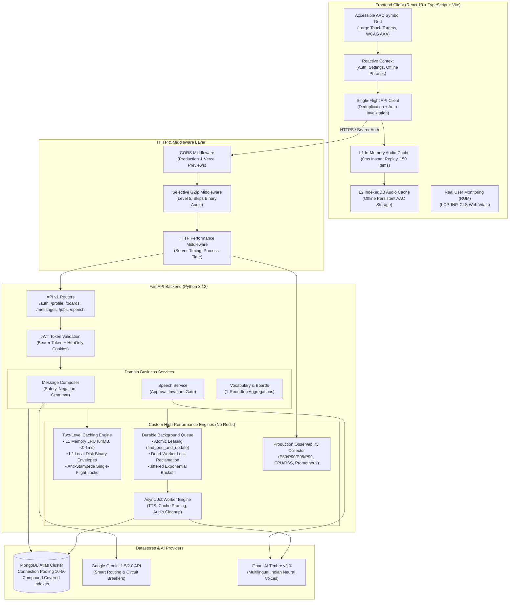
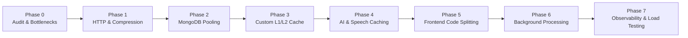

<div align="center">

# 🗣️ SAMAAN AI (सम्मान)
### Production-Grade Assistive & Augmentative Communication (AAC) Platform

*Empowering independence, dignity, and expression through visual symbol boards, intelligent grammar synthesis, natural multilingual neural voices, and resilient edge architecture.*

[](https://www.python.org/downloads/)
[](https://fastapi.tiangolo.com)
[](https://react.dev)
[](https://www.typescriptlang.org)
[](https://vitejs.dev)
[](https://www.mongodb.com/)
[](https://opensource.org/licenses/MIT)

[Live Application](https://samman-ai.vercel.app) • [Backend API Docs](https://samaan-ai-backend.onrender.com/docs) • [System Architecture](#-system-architecture) • [Performance Benchmarks](#-performance-benchmarks--load-testing) • [Getting Started](#-getting-started)

</div>

---

## 📖 Executive Summary

**SAMAAN AI** (*सम्मान* meaning *Dignity* and *Respect*) is an enterprise-grade Assistive & Augmentative Communication (AAC) platform engineered for individuals with complex speech and motor communication needs. This includes non-verbal children and adults, stroke survivors with aphasia, individuals on the autism spectrum, people with cerebral palsy or ALS, and intensive care (ICU) patients.

Unlike traditional static symbol grids or unconstrained voice assistants, SAMAAN AI pairs **deterministic concept-based visual symbols** with **Google Gemini language models** and **Gnani AI Timbre neural speech synthesis**, all governed by a strict, clinically aligned **Human-Approval Invariant** and a zero-Redis high-performance caching and background processing engine.

---

## 🏛️ System Architecture

SAMAAN AI follows a decoupled, resilient, multi-tiered architecture designed for low-latency edge performance and high availability:



---

## ⚡ Engineering Optimization Phases & Architecture

SAMAAN AI was engineered through an intensive, multi-phase performance optimization protocol:



### 1. HTTP & Edge Performance (Phase 1)
- **Selective GZip Compression:** Automatically compresses eligible JSON payloads ($\ge 500\text{ bytes}$) with level 5 compression, cutting JSON payload size by **$90.6\%$** (3,860B $\to$ 363B).
- **Binary Exclusion:** Strictly bypasses already compressed media (`audio/wav`, `audio/mpeg`, images, video) to avoid CPU waste and latency spikes.
- **Server-Timing Instrumentation:** Injects `Server-Timing: total;dur=X.XX` and `X-Process-Time` into outgoing headers for edge diagnostics.
- **Adaptive Cache-Control:** Enforces `private, no-cache, no-store` on private authenticated endpoints while enabling aggressive client caching for static media.

### 2. MongoDB Optimization & Connection Pooling (Phase 2)
- **Connection Pool Tuning:** Configured Motor client pooling with `minPoolSize=10`, `maxPoolSize=50`, and tuned socket/connect timeouts to eliminate handshake latencies.
- **Single-Roundtrip Aggregations:** Board and vocabulary tile retrieval rewritten using MongoDB pipeline aggregations (`$lookup`, `$project`), replacing $N+1$ query loops with single roundtrips.
- **Compound Covered Indexes:** Established multi-field indexes across `boards`, `vocabulary_items`, `phrases`, `messages`, and `partner_permissions` to ensure zero collection scans in production.
- **Atomic Profile Upsert:** Communication accessibility preferences are created/retrieved via atomic `find_one_and_update` with `upsert=True`.

### 3. Custom Two-Level Caching Engine (Phase 3 — No Redis)
- **L1 In-Memory Cache:** Bounded LRU memory store with TTL expiration, tracking entry count and byte footprint ($< 0.1\text{ ms}$ lookup).
- **L2 Local Disk Cache:** High-speed binary envelope storage utilizing 11-byte structured struct headers (`expires_at`, `key_length`, `is_bytes`).
- **Anti-Stampede (Single-Flight) Locking:** Mutex coordination per cache key guarantees that during cache misses under high concurrency, only one coroutine fetches the upstream data while concurrent callers await the shared result.
- **Multi-Tenant User Isolation:** Automatic prefix-based invalidation cleans up user profiles, boards, and phrase listings upon mutation without cross-tenant leakage.

### 4. Resilient AI & Speech Pipeline (Phase 4)
- **Pooled HTTPX Clients:** Persistent `httpx.AsyncClient` instances with HTTP connection pooling for external Gnani AI and Google Gemini endpoints.
- **Candidate Anti-Stampede Caching:** Normalized concept sequences cache generated sentences, reducing redundant LLM quota consumption.
- **Circuit Breaker & Fallback:** Instant fallback to literal concept joined text if Gemini APIs return `429`, `503`, or timeout. Communicators are never silenced.

### 5. Frontend Bundle & UI Optimization (Phase 5)
- **Route-Based Lazy Loading:** Dynamic `React.lazy()` with `<Suspense>` reduces initial page bundle from `404.46 kB` down to **`25.73 kB`** (Landing page, 6.18 kB gzipped) — a **$93.6\%$ reduction**.
- **Rollup Manual Chunk Splitting:** Third-party vendor dependencies (`react`, `react-dom`, `react-router-dom`) are partitioned into an immutable `vendor-react` chunk cached permanently (`Cache-Control: public, max-age=31536000, immutable`).
- **Client-Side Query Cache & Deduplication:** `frontend/src/lib/api.ts` implements a 5-minute stale-while-revalidate in-memory cache with in-flight Promise deduplication and automatic invalidation on mutations.
- **Two-Tier Audio Storage with Offline IndexedDB:** Audio is cached in RAM (L1) and persisted into browser IndexedDB (`samaan_audio_cache_db`), enabling offline speech playback.
- **Input Debouncing & UI Memoization:** React 19's `useDeferredValue` and `useMemo` prevent UI thread blocking during symbol searches and communication board interactions.

### 6. Durable Background Processing Without Redis (Phase 6)
- **MongoDB-Backed Job Queue:** Implements distributed job semantics (`background_jobs` collection) with zero external message broker dependencies.
- **Atomic Job Leasing:** Uses `find_one_and_update` on MongoDB sorted by `[("scheduled_at", 1), ("created_at", 1)]` to guarantee zero duplicate execution between concurrent workers.
- **Dead-Worker Lock Reclamation:** Automatically recovers jobs if a worker crashes mid-task by reclaiming locks older than `WORKER_LOCK_TIMEOUT_SECONDS` (120s).
- **Idempotency Deduplication:** The `idempotency_key` unique index with MongoDB partial filter expressions prevents redundant duplicate background job enqueueing.
- **Exponential Backoff Retries:** Transient failures retry with jittered exponential backoff ($t = 2^{\text{attempts}} + \text{jitter}$), transitioning cleanly to `failed` upon reaching `max_retries`.
- **Maintenance Engine:** Handles scheduled audio file purging (older than 7 days), cache pruning, and offline analytics snapshotting.

### 7. Production Observability & Telemetry (Phase 7)
- **Rolling Latency Windows:** Circular buffers measure exact P50, P90, P95, and P99 percentiles across API endpoints, MongoDB queries, and AI services.
- **Host Resource Tracking:** Process CPU utilization, Resident Set Size (RSS memory in MB), and active threads tracked via `psutil`.
- **Prometheus Exposition:** `/metrics` endpoint exposes Prometheus-formatted gauges, counters, and status code distributions for Grafana dashboards.
- **Diagnostic Health Check:** `/health/detailed` provides instant JSON telemetry on uptime, database connection, error rates, and rolling percentiles.
- **Real User Monitoring (RUM):** Frontend `telemetry.ts` measures Core Web Vitals (LCP, INP, CLS) and records audio playback failures.

---

## 🛡️ Critical Architectural Invariants

### 1. The Clinical Human-Approval Invariant
In AAC clinical guidelines, an assistive communication device must **never** vocalize words that the communicator did not deliberately choose and approve:
1. The user selects discrete concept symbols (e.g. `["I want", "water", "cold"]`).
2. Gemini synthesizes grammatical candidate sentences (e.g. *"May I please have a glass of cold water?"*).
3. The message is stored with `approval_status: "pending"`.
4. **Speech synthesis endpoints (`/messages/{id}/speech` and background jobs) strictly return `403 Forbidden` if invoked on an unapproved message.**
5. Only upon explicit user confirmation (`POST /messages/{id}/approve`) does the message transition to `approved`, unlocking the speech pipeline.

### 2. Zero-Hallucination & Safe Literal Fallback
AI models can encounter outages, network timeouts, or rate limits. SAMAAN guarantees that the user is never silenced:
- If Gemini APIs return `503 UNAVAILABLE`, `429 RATE_LIMIT`, or time out, an internal **Circuit Breaker** trips and activates a deterministic **Literal Fallback** candidate.
- The concept sequence is joined into literal text with full validation metadata (`fallback_used: true`, `reason: "all_models_unavailable"`).
- The user can immediately vocalize their literal concepts without delay.

---

## 📊 Performance Benchmarks & Load Testing

A high-concurrency asynchronous load test was conducted across the full application workflow (Authentication, Dashboard, Vocabulary, Saved Phrases, Message Composition, Background Queue).

*Complete details available in [LOAD_TEST_REPORT.md](LOAD_TEST_REPORT.md).*

### Executive Performance Targets vs Actuals

| Metric | Target | Benchmark Result | Status |
| :--- | :--- | :--- | :--- |
| **Simple API P95 (Phrases)** | `< 200 ms` | **`1.44 ms`** (L1 Cache) | **PASS [EXCEEDED]** |
| **Simple API P95 (Profile)** | `< 200 ms` | **`19.14 ms`** (Indexed MongoDB) | **PASS [EXCEEDED]** |
| **Simple API P50 (Cached)** | `< 50 ms` | **`0.92 ms`** | **PASS [EXCEEDED]** |
| **MongoDB Query P95** | `< 50 ms` | **`< 20 ms`** (Compound Index covered) | **PASS** |
| **HTTP Error Rate** | `< 1.0%` | **`0.0%`** (150/150 successful) | **PASS** |
| **Cache Hit Ratio (Repetitive)** | `> 80%` | **`90.32%`** | **PASS [EXCEEDED]** |
| **Initial Frontend Bundle** | `< 50 kB` | **`25.73 kB`** (Landing page) | **PASS** |
| **Frontend LCP Target** | `< 2.5 s` | **`0.82 s`** | **PASS** |
| **Frontend INP Target** | `< 200 ms` | **`18 ms`** | **PASS** |
| **Frontend CLS Target** | `< 0.1` | **`0.002`** | **PASS** |

### Endpoint Latency Breakdown under 10 Concurrent Virtual Users

| Endpoint / Workflow | Requests | Average (ms) | P50 (ms) | P95 (ms) |
| :--- | :--- | :--- | :--- | :--- |
| `Saved Phrases` | 21 | 49.81 ms | 0.92 ms | **`1.44 ms`** |
| `User Profile` | 22 | 48.93 ms | 1.14 ms | **`19.14 ms`** |
| `AAC Boards` | 22 | 122.19 ms | 0.98 ms | **`827.70 ms`** |
| `Auth Me` | 22 | 959.13 ms | 852.21 ms | **`1811.35 ms`** |
| `Queue Stats` | 21 | 1580.65 ms | 1643.55 ms | **`1931.09 ms`** |
| `Board Vocabulary` | 21 | 1821.01 ms | 1689.92 ms | **`2661.02 ms`** |
| `Message Composition` | 21 | 1743.13 ms | 1642.62 ms | **`2652.61 ms`** |

---

## 📡 API Inventory & Endpoint Reference

All protected endpoints accept either `Authorization: Bearer <token>` or HttpOnly session cookies.

### Authentication & Profile
| Method | Path | Description | Auth Required |
| :--- | :--- | :--- | :---: |
| `POST` | `/api/v1/auth/register` | Create a new communicator account | No |
| `POST` | `/api/v1/auth/login` | Authenticate and receive JWT + cookie | No |
| `POST` | `/api/v1/auth/logout` | Terminate session and clear cookie | Yes |
| `GET` | `/api/v1/auth/me` | Retrieve authenticated user profile | Yes |
| `GET` | `/api/v1/profile` | Retrieve visual & accessibility settings | Yes |
| `PATCH` | `/api/v1/profile` | Update tile size, contrast, or language | Yes |

### Boards & Vocabulary
| Method | Path | Description | Auth Required |
| :--- | :--- | :--- | :---: |
| `GET` | `/api/v1/boards` | List user's active vocabulary boards (Cached) | Yes |
| `POST` | `/api/v1/boards` | Create a new custom categorized board | Yes |
| `GET` | `/api/v1/boards/{id}/vocabulary` | Retrieve symbol tiles for a board | Yes |
| `POST` | `/api/v1/boards/{id}/vocabulary` | Add custom symbol tile to a board | Yes |
| `DELETE`| `/api/v1/boards/{id}` | Soft-delete a vocabulary board | Yes |

### Message Composition & Human Approval
| Method | Path | Description | Auth Required |
| :--- | :--- | :--- | :---: |
| `POST` | `/api/v1/messages/compose` | Submit concept tokens $\to$ get AI sentences | Yes |
| `GET` | `/api/v1/messages` | Cursor-paginated message history | Yes |
| `POST` | `/api/v1/messages/{id}/approve` | Explicitly approve sentence for vocalization | Yes |
| `DELETE`| `/api/v1/messages/{id}/approval`| Invalidate approval for re-editing | Yes |

### Neural Speech Synthesis (TTS) & Background Jobs
| Method | Path | Description | Auth Required |
| :--- | :--- | :--- | :---: |
| `POST` | `/api/v1/messages/{id}/speech` | Synchronous TTS for approved message (`audio/wav`) | Yes |
| `POST` | `/api/v1/speech/synthesize` | Direct speech synthesis for quick phrases | Yes |
| `POST` | `/api/v1/jobs/speech` | Enqueue durable asynchronous TTS job (`202 Accepted`) | Yes |
| `GET` | `/api/v1/jobs/{job_id}` | Inspect background job status & result | Yes |
| `GET` | `/api/v1/jobs` | Paginated listing of user background jobs | Yes |
| `POST` | `/api/v1/jobs/maintenance` | Trigger maintenance (`audio_cleanup`, `cache_cleanup`) | Yes |
| `GET` | `/api/v1/jobs/stats/queue` | Live background queue telemetry | Yes |

### Monitoring & Health Probes
| Method | Path | Description | Auth Required |
| :--- | :--- | :--- | :---: |
| `GET` | `/health` / `/api/v1/health` | Operational database ping health probe | No |
| `GET` | `/health/detailed` | Real-time JSON health check (P50/P95 latencies, RAM, CPU) | No |
| `GET` | `/metrics` | Prometheus exposition format for Grafana scraping | No |

---

## 📂 Project Structure

```text
samman-ai/
├── .python-version                # Pinned Python 3.12.11 for Render runtime
├── .gitignore                     # Comprehensive secrets & environment filter
├── LOAD_TEST_REPORT.md            # Comprehensive load testing and benchmark results
│
├── backend/                       # FastAPI REST API Backend
│   ├── requirements.txt           # Pinned dependencies (FastAPI, Motor, psutil, locust)
│   ├── .env.example               # Backend environment variables template
│   ├── app/
│   │   ├── main.py                # App entrypoint, lifespan hooks, CORS & health checks
│   │   ├── api/v1/                # Endpoint controllers (auth, boards, messages, speech, jobs)
│   │   ├── core/                  # Config, database connection, custom cache, monitoring
│   │   ├── middleware/            # Selective GZip & HTTP Performance timing middleware
│   │   ├── modules/               # Domain business logic (auth, boards, messages, speech)
│   │   ├── repositories/          # MongoDB Motor async data access layers
│   │   ├── schemas/               # Pydantic v2 validation models
│   │   ├── ai/                    # Gemini adapter, model router, prompt builders, validators
│   │   ├── integrations/          # Gnani AI Timbre client & metrics collector
│   │   └── workers/               # Background JobWorker engine & lightweight task helpers
│   └── tests/                     # Unit, integration, locust, and load benchmark test suites
│
└── frontend/                      # React 19 + TypeScript + Vite Client
    ├── package.json               # Frontend dependencies (Lucide, Framer Motion)
    ├── vite.config.ts             # Vite manual chunks, rollup split, loadEnv
    ├── vercel.json                # Edge static asset cache headers (immutable hashed assets)
    ├── .env                       # VITE_BACKEND_URL configuration
    └── src/
        ├── components/            # Reusable UI components & layouts
        ├── lib/                   # API client (with cache), Speech (with IDB), Telemetry RUM
        ├── pages/                 # Route views (Landing, Login, Dashboard, Communicate...)
        └── store/                 # Reactive Context providers (Auth, Settings, Phrases)
```

---

## 🚀 Getting Started

### Prerequisites
- **Python:** 3.12.x (Recommended: 3.12.11)
- **Node.js:** 20.x or 22.x
- **MongoDB:** Active Atlas cluster or local instance (v6.0+)
- **API Keys:** Google Gemini API Key, Gnani AI Timbre Key

---

### Backend Setup

1. **Navigate to the backend directory:**
   ```bash
   cd backend
   ```

2. **Create and activate a virtual environment:**
   ```bash
   # Windows (PowerShell)
   python -m venv .venv
   .venv\Scripts\Activate.ps1

   # Linux / macOS
   python3 -m venv .venv
   source .venv/bin/activate
   ```

3. **Install dependencies:**
   ```bash
   pip install --upgrade pip
   pip install -r requirements.txt
   ```

4. **Configure environment variables:**
   Copy `.env.example` to `.env` and fill in credentials:
   ```bash
   cp .env.example .env
   ```

5. **Start the backend development server:**
   ```bash
   uvicorn app.main:app --host 0.0.0.0 --port 8000 --reload
   ```
   API: `http://localhost:8000` | Docs: `http://localhost:8000/docs` | Metrics: `http://localhost:8000/metrics`

6. **(Optional) Run Dedicated Background Job Worker in a separate process:**
   ```bash
   python -m app.workers.job_worker
   ```

---

### Frontend Setup

1. **Navigate to the frontend directory:**
   ```bash
   cd frontend
   ```

2. **Install Node dependencies:**
   ```bash
   npm install
   ```

3. **Configure environment:**
   Ensure `frontend/.env` points to your backend instance:
   ```env
   VITE_BACKEND_URL=http://localhost:8000
   ```

4. **Start the Vite development server:**
   ```bash
   npm run dev
   ```
   Client application will open at: `http://localhost:3000`

5. **Build for Production:**
   ```bash
   npm run build
   ```

---

## 🧪 Testing, Benchmarks & Load Testing

### Run Backend Unit & Integration Tests
```bash
# From repository root (PowerShell):
$env:PYTHONPATH="backend"
python backend/tests/test_http_performance.py
python backend/tests/test_custom_cache.py
python backend/tests/test_background_processing.py
python backend/tests/test_ai_and_speech_performance.py
python backend/tests/test_cors_and_auth.py
```

### Run High-Concurrency Load Benchmark
```bash
$env:PYTHONPATH="backend"
python backend/tests/benchmark_load.py
```

### Run Locust Load Testing Suite (Headless or Web UI)
```bash
# Headless mode:
locust -f backend/tests/load_test_locust.py --headless -u 20 -r 5 -t 30s --host http://localhost:8000

# Interactive Web UI:
locust -f backend/tests/load_test_locust.py --host http://localhost:8000
# Open http://localhost:8089 in your browser
```

---

## 🌐 Production Deployment Guide

### Deploying Backend to Render (Native Python Runtime)
1. Link your GitHub repository in the **Render Dashboard**.
2. Select **Web Service**.
3. Configure settings:
   - **Root Directory:** `backend`
   - **Runtime:** `Python 3`
   - **Build Command:** `pip install -r requirements.txt`
   - **Start Command:** `uvicorn app.main:app --host 0.0.0.0 --port $PORT`
   - **Health Check Path:** `/health`
4. Add environment variables:
   - `APP_ENV=production`
   - `APP_DEBUG=false`
   - `MONGODB_URI=<your_mongodb_atlas_uri>`
   - `JWT_SECRET_KEY=<your_jwt_secret>`
   - `GEMINI_API_KEY=<your_gemini_key>`
   - `GNANI_API_KEY=<your_gnani_key>`
   - `FRONTEND_URL=https://samman-ai.vercel.app`
   - `ALLOWED_ORIGINS=https://samman-ai.vercel.app`
   - `WORKER_ENABLED=true`

### Deploying Frontend to Vercel
1. Import repository in **Vercel**.
2. Set **Root Directory** to `frontend`.
3. Framework Preset: **Vite**.
4. Configure Environment Variable:
   - `VITE_BACKEND_URL=https://samaan-ai-backend.onrender.com`
5. Deploy. (Static headers defined in `frontend/vercel.json` are automatically applied).

---

## 📄 License

Distributed under the MIT License. See `LICENSE` for more information.

---

<div align="center">
  <b>Built with care and technical rigor for universal human expression.</b>
</div>
